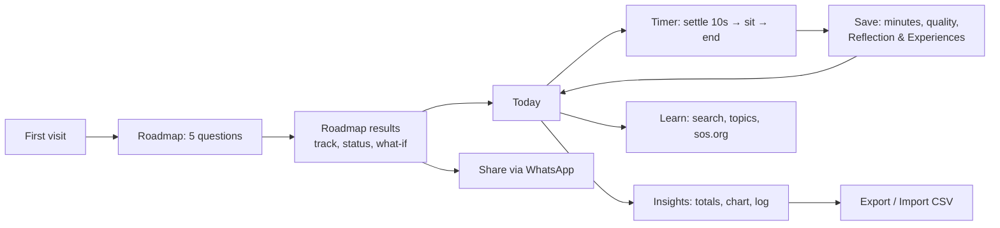

# Meditation Copilot — Product Intent

> **Status:** Prototype · **Owner:** Arvind Naik · **Last updated:** 9 Nov 2026
> **Prototype only. Not an official or approved Science of Spirituality (SOS) app.**

## 1. Purpose
Meditation Copilot helps a meditator build a steady daily practice and see a clear, encouraging path to a long-term spiritual goal: **10,000 effective meditation hours**.

*Small moments. Daily practice. Inner transformation.*

It answers three questions for the user:
1. **Where am I?** Hours completed so far, streaks, and how consistent the practice is.
2. **Where am I going?** A roadmap to 10,000 hours, with milestones, a projected completion age, and what it would take to get there sooner.
3. **How do I keep going today?** A simple timer, gentle bells, a place to record reflections and experiences, and guidance and links for learning.

## 2. Target users
| Persona | Need |
|---|---|
| **Regular meditator** (primary) | Track daily sittings, stay consistent, see long-term progress |
| **New meditator** | Learn how to begin, build a habit, find instruction and a local center |
| **Community / center** (future) | Encourage practice, share inspiration, point people to programs |

## 3. Scope

### In scope (current prototype)
- **Roadmap:** a 5-question planner (date of birth, journey start, average minutes, quality, goal age) and a linear milestone track to 10,000 hours.
- **Today:** thought for the day, daily target ring, streak, weekly totals.
- **Timer:** a 10-second settling moment, start and end bells, countdown or open-ended sitting, and Reflection & Experiences notes.
- **Insights:** totals, a chart (14 days / 12 weeks / all time), patterns, an editable session log, and CSV export/import.
- **Learn:** search across guidance articles, featured topics, links to sos.org, and help contact.
- **Platform:** an installable, offline-capable mobile web app (PWA). All data stays on the device.

### Planned (not built)
- **Phase B — Calendar:** a daily schedule, a month view, reminders, and export to the phone's calendar.
- **Phase C — Profile:** optional login, sync across devices, preferences, and push reminders.
- **Phase D — Buddy:** an AI companion for encouragement, weekly reflections and planning help.

### Out of scope
- Teaching meditation technique or SOS doctrine. The app links to official SOS sources instead.
- Medical or mental-health advice.
- Social feeds or public profiles.

## 4. Core user flow

**Daily loop:** Today → Timer → Save reflection → see progress on Today and the Roadmap.

## 5. Key concepts
- **Effective minutes** = minutes sat × quality %. Example: 60 min at 75% = 45 effective minutes.
- **Hours completed** = logged effective hours + an estimate from the user's answers for the period before they started logging.
- **Pace** = the last 30 days of logged practice (once 7+ days are logged); otherwise the user's answers.
- **The goal is fixed** at 10,000 effective hours and can't be changed by the user.

## 6. Business model
> **Open question — not yet decided.** Current working assumption:
- Free and non-commercial: no ads, no in-app purchases, no data monetization.
- Today's running cost is $0 (GitHub Pages hosting).
- Future cost drivers: a backend for login, sync and push notifications (Phase C), and AI usage (Phase D). Options to cover these include sponsorship or hosting by an organization, usage caps, or optional donations.
- Any association with SOS branding, content or distribution needs **SOS approval**.

## 7. Expected outcomes and success measures
| Outcome | Example measure (once measurable) |
|---|---|
| More consistent daily practice | % of users with 5+ practice days per week; average streak length |
| Longer and deeper sittings | 30-day trend in average minutes and quality per user |
| Clear sense of progress | Users who complete the Roadmap; return visits per week |
| Easier path to learning | Learn searches and clicks through to sos.org |
| Organic growth | Shares via "Share My Spiritual Journey" and "Inspire a Friend" |

> No analytics are collected today (privacy-first prototype). Measuring these outcomes needs a privacy-reviewed, opt-in approach. See tech-spec.md §8.

## 8. Principles
- **Encouraging, never judgmental:** behind-schedule users are met with "Your goal is within reach."
- **Private by default:** data stays on the device unless the user chooses otherwise.
- **Simple and calm:** large touch targets, minimal distraction during a sitting.
- **Faithful to the source:** spiritual content comes only from approved SOS material, with citations.

## 9. Open questions
1. SOS review and approval of the app, its name, and its branding.
2. Approved quotes for "Thought for today" and approved article text for Learn.
3. The business model and who funds Phases C and D.
4. The audience: personal use, a local center, or wider distribution.
