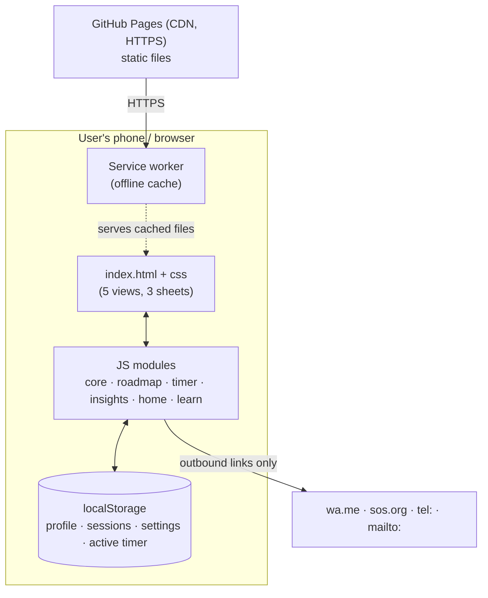

# Meditation Copilot — Technical Specification

> **Status:** Prototype (v0.11.0) · **Last updated:** 10 Nov 2026 · **Repo:** `arvindknaik/Meditation-Copilot` · **Live:** https://arvindknaik.github.io/Meditation-Copilot/
> Sections are brief by design and will grow as the app expands.

## 1. Architecture overview
The app is a **static, client-only Progressive Web App (PWA)**. There is no server or database of our own. All logic runs in the browser.

- **Today (built):** a guest user's data lives in the device's `localStorage`.
- **Signed in (built in v0.7.0, §13):** users sign in with Google or Microsoft, and their data is synced to **their own** Google Drive or OneDrive app folder. This is a "bring your own storage" model: we hold no user data. The optional passphrase encryption is still to come.

## 2. Tech stack and rationale
| Layer | Choice | Why |
|---|---|---|
| UI | Plain HTML + CSS (custom properties for theming) | No build step; easy for anyone to edit; fast on low-end phones |
| Logic | Vanilla JavaScript (ES5-style IIFE modules, global `MC` namespace) | No framework or bundler. Classic scripts also work when the file is opened directly (`file://`) |
| Storage | `localStorage` (JSON) | Zero backend and private by default; enough for years of sessions (~100 bytes per session) |
| Offline / install | Web App Manifest + Service Worker | Home-screen install, offline use, app-like full-screen view |
| Audio | Web Audio API (synthesized singing bowl) | No audio files; works offline |
| Hosting | GitHub Pages | Free, HTTPS by default, CDN, deploys on `git push` |
| Charts | Hand-built SVG | A single small chart doesn't justify a charting library |
| Identity | Google Identity Services; MSAL.js (Microsoft) | Official browser libraries; work with no server |
| User storage | Google Drive `appDataFolder`; OneDrive app folder (Microsoft Graph) | The user owns their data; $0 cost; narrowest permissions |
| Usage analytics | Cookie-free counter (e.g. GoatCounter), off until configured | Anonymous trends without personal data |

**Later:** a serverless function (e.g. Cloudflare Workers) for push reminders and to call an AI model for Buddy (Phase D), which keeps API keys off the client. User data stays in the user's drive.

## 3. Infrastructure and network
- **Hosting:** GitHub Pages serves static files from the `main` branch root over HTTPS. Pages caches files for about 10 minutes.
- **Network calls:** the app makes **no API calls**. The only requests are for its own static files. External destinations are user-initiated links only: `wa.me` (sharing), `sos.org` (Learn), and `tel:` / `mailto:` (help).
- **Deploy:** `push.bat`, which runs `git add -A` → commit (prompts for a message) → `git push`. The site updates in 1–2 minutes.
- **Custom domain (optional, future):** add a `CNAME` file and update DNS; HTTPS is automatic.

## 4. Code structure (components)
| File | Responsibility |
|---|---|
| `index.html` | App shell: header, 5 views (Today, Timer, Insights, Roadmap, Learn), tab bar, dialogs (session, target, import) |
| `css/styles.css` | Design tokens (purple/gold palette, light/dark), components (cards, chips, sheets, track, chart) |
| `js/core.js` | Storage, dates, session store, aggregates, **roadmap calculation**, **CSV format/validation**, bells, theme, hash router |
| `js/roadmap.js` | 5-question planner, results, linear milestone track, what-if slider, sharing, install prompt |
| `js/timer.js` | 10-second settling moment, countdown/open sitting, start/end bells, pause, wake lock, crash-safe resume |
| `js/sessions-ui.js` | Save / add / edit / delete a sitting (bottom sheet) |
| `js/insights.js` | Totals, SVG chart (14 d / 12 w / all time), patterns, session log, CSV export/import |
| `js/home.js` | Today screen, daily target |
| `js/learn.js` + `js/knowledge.js` | Search with ranking, paginated results, articles; content file (draft for SOS review) |
| `js/quotes.js` | Master quote file for "Thought for today" (approved quotes only) |
| `js/config.js` | Public configuration: Google and Microsoft Client IDs, analytics endpoint, support contact |
| `js/diag.js` | Private diagnostic log, error capture, `MC.track()` anonymous usage events |
| `js/sync.js` | Google (GIS token client + Drive `appDataFolder`) and Microsoft (PKCE redirect + Graph app folder) providers; sync engine (pull → merge → push, debounced auto-sync) |
| `js/calendar.js` | Calendar tab: personal schedule (synced), month view, day agenda (kept/missed), next sitting, in-app reminders, `.ics` export, "Scheduled Sitting Kept" reward |
| `js/challenge.js` | New Seekers' 42-day challenge: rules engine (replays each day) and the seeker Roadmap screen |
| `js/rewards.js` | Rewards: rules list, points, levels, badges (computed from data) |
| `js/profile.js` | "Are you an initiate?" question, initiation date and Master, Profile section |
| `js/account.js` | Welcome / sign-in choice, guest mode and warning, Account & settings sheet, backup reminder, send diagnostics |
| `privacy.html` | Privacy notice (draft for review); needed for the Google/Microsoft consent screens |
| `sw.js` · `manifest.json` · `icons/` | Offline caching, install metadata, app icons |

**Routing:** hash-based (`#home`, `#timer`, `#insights`, `#roadmap`, `#learn?a=<article>`).
**Events:** a tiny pub/sub (`MC.on/emit`) re-renders views on `data` and `profile` changes.

## 5. Data model (localStorage)
| Key | Shape |
|---|---|
| `meditation-copilot:v1` (profile) | `{ dob: 'YYYY-MM-DD', start: 'YYYY-MM-DD', minutes: '60', quality: 75, goalAge: 90 }` |
| `meditation-copilot:sessions` | `[{ id, start: epochMs, minutes: number, quality: 0–100, note: string, source: 'timer'\|'manual' }]` |
| `meditation-copilot:settings` | `{ dailyTarget, preset, startBell, endBell, lastQuality }` |
| `meditation-copilot:active` | Running timer: `{ startedAt, pausedAt, pausedMs, target, endRung }` |
| `meditation-copilot:theme` | `'light'` \| `'dark'` (absent = Automatic) |
| `meditation-copilot:deleted` | Tombstones `[{ id, at }]` so deletions sync across devices (kept 1 year) |
| `meta` · `account` · `diag` | Change times for profile/settings; account mode, guest acknowledgement, last export; diagnostic log (≤300 events, ≤90 days) |

Each session also has **`updatedAt`** (epoch ms), used to resolve sync conflicts.

**CSV interchange (export and import):**
`date,start_time,minutes,quality_pct,effective_minutes,reflection,source`
The header must match exactly. Rows are strictly validated, and any invalid row rejects the whole file. Rows that overlap an existing sitting are skipped and reported. UTF-8 with BOM, RFC 4180 quoting.

## 6. Key data flows
- **Sitting:** Begin → 10 s settle → `active` saved → tick every 250 ms (time computed from timestamps, so it survives reloads) → End → sheet → `sessions.add` → `emit('data')` → views re-render.
- **Roadmap calculation** (`MC.compute`):
  - Completed = (profile effective/day × days before first log) + Σ logged effective minutes ÷ 60.
  - Pace = last ≤30 complete days of logs (after 7+ days of logging), otherwise the profile.
  - Required = remaining × 60 ÷ days to goal age.
  - Ahead if pace ≥ required.
- **Import:** parse → validate all → (reject with errors) or (overlap check → add the non-conflicting rows → summary).
- **Sync (groundwork built, providers next):** `MC.snapshot()` produces one JSON document; `MC.mergeSnapshot(remote)` merges it. Sittings are matched by id and the newer `updatedAt` wins. A tombstone removes a sitting unless the sitting was edited later. Profile and settings: the newer copy wins. Merging is idempotent (merging the same snapshot twice changes nothing).

## 7. Design system
- **Palette:** purple `#5b2a86 / #7b3fb3` + gold `#d9ae36`; separate dark-mode tokens, toggle or system setting.
- **Type:** serif headings (Palatino/Georgia stack), system sans body. No web fonts, for offline use and speed.
- **Components:** cards, chips, segmented control, bottom sheets (`<dialog>`), progress ring, linear milestone track, bar chart with tooltip, toast.
- **Mobile-first:** 44px+ touch targets, safe-area insets, bottom tab bar, `prefers-reduced-motion` respected.

## 8. Security and privacy
- **No accounts, no server, no third-party scripts, no tracking or analytics.** Nothing leaves the device unless the user exports or shares.
- **XSS:** all user text (reflections, CSV) is HTML-escaped before rendering (`MC.esc`).
- **Input validation:** strict validation on forms and CSV import (types, ranges, future dates, overlaps).
- **External links** open with `rel="noopener"`.
- **Recommended next:** add a Content-Security-Policy `<meta>` tag (`default-src 'self'`); a privacy notice; a data-deletion control in settings.
- **Phase C/D implications:** see §13 (identity, storage, encryption, logging). For Buddy: consent for AI processing of reflections, and per-user rate limits.

## 9. Reliability and data durability
- `localStorage` can be cleared by the browser or the user (and iOS may evict data from sites that aren't installed). **Mitigations:** CSV export/import today; cloud sync in Phase C.
- The timer stores timestamps, so its state survives reloads and crashes.

## 10. Caching and release process
- **Service worker strategy:** pages and JS/CSS are network-first with `cache: 'no-cache'` (offline fallback to the cache); icons and the manifest are cache-first.
- **Release checklist:** (1) bump `CACHE_VERSION` in `sw.js` **and** the `?v=` number on the css/js links in `index.html` (and `MC.VERSION` in `core.js`); (2) add new files to `ASSETS`; (3) test locally (`python -m http.server`); (4) run `push.bat`.
- **Rollback:** `git revert <commit>` then push.

## 11. Monitoring and operational support
- **Anonymous usage trends:** `MC.track(event)` sends cookie-free counts (e.g. `app_open`, `sitting_saved`, `csv_export`) once `analyticsEndpoint` is set in `config.js`. Users can opt out in Account & settings.
- **Individual troubleshooting:** each device keeps a private diagnostic log (events and errors only). **"Send diagnostics to support"** shares it, by the share sheet or by a downloaded file plus a pre-filled email, only when the user chooses.
- **Support contact (shown in app):** 612-216-4444 · MinneapolisCenter@sos.org.
- **Future options:** privacy-friendly, opt-in usage counts; client error reporting; uptime check on the Pages URL; a status note in the README.

## 12. Testing
- Manual testing on mobile, plus headless-browser (Playwright) scripts used during development. These cover onboarding, the timer, insights, CSV validation, Learn search, offline mode, and `file://` mode. The scripts aren't in the repo yet; adding them is recommended.
- **Browser support:** current iOS Safari, Android Chrome, desktop Chrome/Edge/Safari/Firefox.

## 13. Identity, storage and logging (Phase C design)

### 13.1 Decisions (10 Nov 2026)
| Topic | Decision |
|---|---|
| Sign-in | Google, and Microsoft **personal accounts only** for now |
| Storage | User's own **Google Drive app data folder** (hidden) or **OneDrive app folder** (`Apps/Meditation Copilot`) |
| Encryption | **No passphrase by default** (provider encryption plus a private app folder). **Optional passphrase** (client-side AES-256-GCM, PBKDF2-SHA-256 key) with a one-time recovery code |
| Logging | Anonymous usage trends for everyone; individual diagnostics shared only by the user |
| Guest mode | Allowed. Explicit warning that data may be lost; backup reminders; upgrade to an account later moves the data |
| Domain | Pilot on `arvindknaik.github.io` for a few weeks, then a subdomain of `sosmn.org` (e.g. `copilot.sosmn.org`) |

### 13.2 Sign-in (built, v0.7.0)
- **Google:** Google Identity Services token client (pop-up; the library is preloaded so Safari allows the pop-up on tap). Scopes `openid email drive.appdata`. Access tokens last about 1 hour and there's no refresh token in the browser, so after that the app shows **Reconnect** (one tap). In Testing mode, consent also expires every 7 days.
- **Microsoft:** Authorization Code + PKCE implemented directly (no library) against `login.microsoftonline.com/consumers`, using a full-page redirect. Scopes `openid profile offline_access User.Read Files.ReadWrite.AppFolder`. The refresh token (about 24 h for single-page apps) renews access silently; after that the user reconnects.
- **Token storage:** `localStorage` key `meditation-copilot:tokens` on the device only, never in the data file. Sign-out clears tokens (Google tokens are also revoked); users can revoke access in their Google/Microsoft account.

### 13.3 Data file and sync
- **One file:** `meditation-copilot.json` (or `.enc` when a passphrase is set), holding the `MC.snapshot()` document.
- **Sync cycle:**
  - On app open and on resume: pull the file → `mergeSnapshot` → push the merged copy if anything changed.
  - After local changes: push, with a few seconds' delay so several edits go up together.
  - OneDrive uploads use `If-Match: <eTag>`; on `412` the engine pulls, merges and retries (up to 2 times). Google Drive has no equivalent check, so a simultaneous edit on two devices relies on the merge at the next sync. Uploads happen only when the merged data differs from the cloud copy.
- **Offline first:** `localStorage` remains the working copy; sync resumes when online.
- **Guest → account:** on first sign-in, local guest data is merged into the cloud copy.
- **Optional encryption envelope:** `{ v, kdf: 'PBKDF2-SHA256', iter: 600000, salt, iv, ct }`. The recovery code wraps the same data key. A lost passphrase and lost recovery code mean the data can't be recovered.

### 13.4 Logging and privacy rules
- Never log reflection text, names, emails or birth dates. Durations are bucketed (e.g. `30-59`).
- Analytics are cookie-free with no user ID; the diagnostic log is device-local and kept ≤90 days.
- The privacy notice (`privacy.html`) is a draft and must be reviewed before public launch.

### 13.5 Registrations (owned by the product owner)
| Provider | What | Setting |
|---|---|---|
| Google Cloud | Project, Google Auth Platform (consent screen), Web client | Origins: `https://arvindknaik.github.io`, `http://localhost:8000`; *Testing* mode, ≤100 test users |
| Microsoft Entra | App registration (SPA), personal accounts only | Redirect URIs: `https://arvindknaik.github.io/Meditation-Copilot/`, `http://localhost:8000/` |

Client IDs go into `js/config.js`; they are public identifiers. On moving to `sosmn.org`, add the new origin and redirect URI to both registrations. Step-by-step guide: `docs/setup-accounts.md`.

## 14. User types, seeker challenge and rewards (v0.8.0)

### 14.1 User types
- `profile.userType`: `'seeker'` (New Seeker) or `'initiated'` (Initiated Member). It's asked once after sign-in or guest choice, and can be changed in Account & settings.
- Initiates also give `profile.start` (initiation date, the same value as the Roadmap's journey start) and `profile.initiatedBy`: Sant Rajinder Singh Ji Maharaj · Sant Darshan Singh Ji Maharaj · Sant Kirpal Singh Ji Maharaj · Baba Sawan Singh Ji Maharaj · Other.
- **Roadmap by type:** initiates get the 10,000-hour Roadmap; seekers get the 42-day challenge only (no 5 questions).
- **Privacy:** user type and initiation details sync like other profile data but are **never** sent to analytics or diagnostics.

### 14.2 Seeker 42-day challenge
- `profile.challenges = [{ startedOn, endedOn? }]`. Day 1 starts when the seeker taps Start; a restart closes the current run and starts a new one, keeping history.
- Each completed day is replayed with: target = 15 min for days 1–21, then `round(15 + (n − 21) × 15/21)` for n = 22…42 (reaching 30); a day is met when the total **actual** minutes that day ≥ target.
  - Missed in phase 1 (count < 21): count − 1 (minimum 0).
  - Missed in phase 2: count → 21; more than 7 phase-2 misses in total → count 0 (back to day 1).
  - Today is never counted as missed until it's over.
- The Today screen's daily target follows the challenge, so seekers can't edit it while a challenge runs. After completion it's 30 min.

### 14.3 Rewards
- **Rules list** in `js/rewards.js` (`id`, `category`, `icon`, `name`, `points`, `repeat`, `who`, `count(data)`). Points = Σ times × points, **computed from data**, so they're never double-counted, sync automatically, and are never taken away.
- **Current rules:**

  | Rule | Points |
  |---|---|
  | First sitting | 10 |
  | Daily target met | 5 / day |
  | 7-day streak (at 7, 14, 28, 35…) | 25 |
  | 21-day streak (every 21) | 50 |
  | Challenge Phase 1 complete | 50 |
  | 42-day challenge complete | 100 |
  | Logged hours: 25 / 50 / 100 / 250 / 500 / 1,000 / 2,500 / 5,000 / 10,000 | 25 / 50 / 100 / 150 / 200 / 250 / 300 / 500 / 1,000 |

  Hours count **only sittings logged in the app**, not the Roadmap estimate.
- **Levels:** Seed 0 · Sprout 100 · Bud 300 · Bloom 700 · Lotus 1,500 · Radiant Lotus 3,000. Initiates' thresholds are **× 2**.
- **Categories for future rules:** practice, consistency, goals, learning, community. New rewards are added as new rules.
- **Celebration:** a toast appears when a newly earned reward is first seen on a device (tracked in `meditation-copilot:rewards-seen`).

## 15. Calendar: personal schedule (v0.9.0)
Full requirements for the calendar and SOS-hosted events are in `docs/events-requirements.md`.

- **Synced collection:** `MC.collection('schedule')` gives a generic list with `createdAt`/`updatedAt` and deletion tombstones. It's included in `MC.snapshot().collections` and merged like sittings, so new synced lists need no core changes.
- **Sitting time:** `{ id, title, time 'HH:MM', minutes, days [0–6, 0 = Sunday], remind (−1 = none, else minutes before), enabled }`. Several per day are allowed.
- **Kept:** a logged sitting starts between 30 min before and 60 min after the scheduled time. Matching is greedy and earliest-first, one sitting per scheduled time, and counts only from the day the time was created.
- **Reminders:**
  - **Phone calendar:** `.ics` export (weekly `RRULE`, `VALARM`) for reliable reminders.
  - **In-app:** a message, plus a notification if permitted, while the app is open.
  - **Push when the app is closed:** needs the Part 2 server.
- **Reward:** "Scheduled Sitting Kept", 10 points each, registered through `MC.rewards.addRule()`.
- **SOS-hosted events:** built in v0.10.0, see §16.

## 16. SOS-hosted events (v0.10.0, extended in v0.11.0)
Requirements and decisions D1–D9 are in `docs/events-requirements.md`. Deployment steps are in `docs/setup-cloudflare.md`.

- **Backend (pilot):** a Cloudflare Worker (`api/src/index.js`) with a D1 (SQLite) database. `api/migrations/` holds the numbered schema changes, applied with `npm run db:remote` (Wrangler records which have run). `api/schema.sql` is the full current schema for reference. It is plain JavaScript with standard SQL and no Cloudflare-only libraries, so it can move to Azure Functions with Azure SQL or PostgreSQL later.
- **Data held on the server:** users (id `provider:sub`, email, name, optional phone, text consent and its date, date contact details were confirmed), series, events, RSVPs and check-ins. It holds no sittings, reflections, profile or initiation details: those stay in the user's own storage.
- **Identity:**
  - Google access tokens are checked with `tokeninfo`, and the audience must be our client ID.
  - Microsoft `id_token`s are verified with RS256 against the consumers JWKS, with audience and issuer checks.
  - The server then issues its own 30-day HS256 session token.
  - Admins are listed in the `ADMIN_EMAILS` secret.
  - `DEV_LOGIN` exists for local testing only.
- **Endpoints:**
  - Session, profile and events: `POST /api/session`, `GET /api/me`, `GET /api/events`, `GET /api/events/:id`, `PUT …/rsvp`, `POST …/checkin`.
  - Contact: `PUT /api/me/contact` (`{phone, smsOk}`). US numbers are normalized to `+1…`; `smsOk` needs a phone.
  - Center QR: `POST /api/centers/:id/checkin` (`{eventId?}`). Returns `open:false` (with the next event), `choose:[…]` when two events overlap, or the check-in.
  - Admin: `/api/admin/events` (create, edit, cancel/restore, new code), attendees (JSON or CSV, now with phone and texts_ok), host check-in and undo, user search.
- **Repeating events:**
  - The app works out the dates in local time (so daylight saving is right): weekly, every other week, or monthly on the same nth weekday (or "last"). Up to 120 dates.
  - Skipped dates are left out. The app sends `{repeat:{freq}, occurrences:[{startsAt, endsAt}]}`; the server creates a `series` row plus one event per date, each with its own code, RSVPs and check-ins.
  - `PATCH …?scope=future` applies field changes to this and later events in the series and moves their times by the same amount. `POST …/cancel?scope=future` (and `restore`) work the same way.
  - Cancelled events stay listed: struck through and tagged on the list and day agenda, with a hollow dot on the month grid.
- **Contact details:** RSVP and check-in return `428` until the user has confirmed contact details once. The app then shows the contact sheet (email from sign-in, read-only; optional phone; optional text opt-in; privacy notice) and retries. Host check-in skips this.
- **Visibility:** guests see public events only. The online link is shown only to signed-in users, and the check-in code only to admins.
- **Check-in:**
  - Methods: the center QR poster (`#checkin`, permanent, printed from the admin's events card), the event's 4-digit code or door QR (`#event?e=<id>&c=<code>`), host check-in, or "Join & check in" for online events.
  - From the poster, a visitor who isn't signed in is asked to sign in. A pending flag (20 min) finishes the check-in after the Google pop-up or the Microsoft redirect.
  - In-person check-in is open from 30 min before start until 30 min after the end. Online check-in is open from 15 min before start until the end.
  - Check-in is idempotent and sets the RSVP to Going.
- **Rewards:** `hosted_online` earns 25 points and `hosted_in_person` earns 50, computed from the user's check-ins (cached on the device).
- **App:** `js/events.js` (events card, event page, admin tools, create/edit form) and `js/vendor/qrcode.js` (qrcode-generator 1.5.2, MIT). The server address is `apiBase` in `js/config.js`. If it is empty, the Calendar shows an "SOS events — coming soon" card with a link to sos.org.
- **Security:** a CORS allowlist (`ALLOWED_ORIGINS`). Secrets are set with `wrangler secret put` and never committed.
- **Not built yet:** email reminders (B5, through a cron trigger and an email provider), SMS, email-link sign-in, and a waitlist (on hold).

## 17. Known limitations
- iOS doesn't play the bells while the screen is locked (mitigated by keeping the screen awake).
- No reminders or notifications yet (Phase B/C).
- Data is per-device until sync ships; guest data can be lost (warning and backup reminders in place).
- Streaks and "target met" for days outside a challenge use the **current** daily target (past target changes aren't stored).
